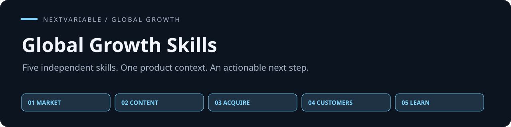

# Global Growth Skills

**海外增长的五个独立 Skill：从选市场，到讲清价值、获得客户、促成购买，再用实验决定下一步。**

[](https://github.com/NextVariable/global-growth-skills/actions/workflows/validate.yml) [](LICENSE) [](https://agentskills.io/specification)

[选一个 Skill](#choose-a-skill) · [整套安装](#quick-start) · [能力范围](docs/capabilities.md) · [交接示例](handoff-example.md) · [验证](validation/README.md)

给出产品背景、当前问题和资源限制，拿到一个能使用的判断、成稿、操作包或复盘决定。可以只用一个，也可以接续工作；每个 Skill 都有自己的仓库、安装单元和版本。

## Choose a skill

| 现在要解决什么 | 独立 Skill | 一次任务的产物 |
|---|---|---|
| 进入哪个海外市场，先服务谁 | [01 · 市场研究与 GTM 战略](https://github.com/NextVariable/global-gtm-strategy-skill) | 客户选择、竞争取舍、进入路径、下一验证 |
| 怎样让客户理解产品价值 | [02 · 产品定位与增长内容](https://github.com/NextVariable/global-growth-content-skill) | 定位、页面、文章、README、社媒与视频脚本 |
| 怎样把合适的用户带来 | [03 · 产品发布与渠道获客](https://github.com/NextVariable/global-launch-acquisition-skill) | 渠道选择、发布包、合作、排期与执行核验 |
| 怎样推动购买、首次价值和续费 | [04 · 销售转化与客户增长](https://github.com/NextVariable/global-sales-retention-skill) | 客户行动、试点、跟进、激活、续费与扩展 |
| 下一步做什么，结果值不值得继续 | [05 · 增长实验执行与复盘](https://github.com/NextVariable/global-growth-experiments-skill) | 验证设计、测量、护栏、结果与投入决定 |

每个仓库都有可直接阅读的任务示例。没有其他四个也能使用其中一个；本合集维护目录与安装入口，不新增第六个包办一切的 Skill。

## Quick start

单独安装时，进入相应仓库使用标准 `npx skills add` 命令。整套或选择多个安装，用本合集的指定版本工具，需要 Git 和 Python 3.10+：

```sh
git clone https://github.com/NextVariable/global-growth-skills.git
cd global-growth-skills
python3 scripts/install.py --dest ~/.agents/skills
```

上一步只预览，确认后安装：

```sh
python3 scripts/install.py --dest ~/.agents/skills --install
```

只安装获客和客户增长：

```sh
python3 scripts/install.py --dest ~/.agents/skills --only global-launch-acquisition global-sales-retention --install
```

已有同名目录会停止，不覆盖你的版本。工具先下载全部选定版本，再复制完整技能单元并保留许可；不执行下载内容中的脚本。具体仓库和固定提交见 [catalog.json](catalog.json)，不自动跟随各仓库最新分支。更新前保存旧版及修改，再在空目录试装。

重新加载客户端后，从当前任务调用：

```text
使用 $global-launch-acquisition。
我们做英语日志排查工具，已有可运行示例、落地页和45秒演示。
两周能投入12小时，预算300美元，最多支持4个新团队。
请选一条优先获客路径，给具体执行包、时间安排和观察方法。
本次只准备，不对外发送或发布。
```

## One context, five responsibilities

一份[产品背景](templates/product-brief.md)就能开始：产品做什么、这次决定什么、服务谁、已有证据、限制与授权。它可以是一段文字，不需要另建数据库。

市场判断交给内容制作；内容与条件交给渠道；用户主动需求交给客户增长；实际动作与结果交给实验。新证据再回到受影响的判断。可使用[普通文字交接示例](handoff-example.md)，保留事实、未知、版本和下一任务。

完整覆盖与专项边界见[能力范围](docs/capabilities.md)。方法指令以中文为主，对客产物按目标语言生成。模型、搜索、浏览、CRM或发布工具由客户端提供；实际外部动作需要相应权限和可核验结果。

## Quality

用任务是否完成、事实是否准确、动作能否执行、变化是否正确传播来评价；框架多和文字长都不能证明质量。设计和贡献标准见 [CONTRIBUTING.md](CONTRIBUTING.md)。

```sh
PYTHONDONTWRITEBYTECODE=1 python3 scripts/validate.py
```

合集验证目录与安装保护，各技能单独维护方法和测试。[验证说明](validation/README.md)区分自动检查、模型试用和真实业务效果；[质量边界](docs/quality.md)说明哪些结论目前可以成立。现有检查不证明真实获客、成交或留存收益。

## English

Five independent Agent Skills for international GTM: strategy, positioning and content, launch and acquisition, sales and retention, and growth experiments. Start with one product context and use the skill that matches the current decision. This repository provides a versioned catalog and installer; each skill remains independently maintained.

[MIT License](LICENSE). Each installed unit retains its bundled license and applicable notices.
