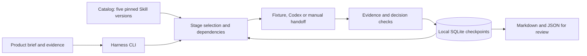

# Global Growth Skills & GTM Harness

An open-source, domain-specific Agent Harness for Global Go-to-Market Research and Planning.

Turn a product brief into research-backed decisions, channel plans and draft materials for human review. Pick one Skill for a focused question or run several stages with shared context and evidence.

- **Global Growth Skills** are five independently installable Agent Skills.
- **Global GTM Harness** is the optional local system for running and coordinating GTM workflows across those Skills.

[Quick start](#quick-start) · [Skill map](#skill-map) · [Example outputs](#example-outputs) · [Documentation](docs/README.md)

## Release and maintenance status

**Stable: [v1.0.0](https://github.com/NextVariable/global-growth-skills/releases/tag/v1.0.0).** Active development is frozen and the project is in maintenance mode. V1.1 underwent real-model acceptance and received **FAIL**. [PR #3](https://github.com/NextVariable/global-growth-skills/pull/3) remains Draft / Blocked. Real commercial outcomes were not measured. [Release status and maintenance record](docs/maintenance.md)

## Skill map

| Decision | Independent Skill | Typical output |
|---|---|---|
| Which market and customers should we pursue first? | [GTM Strategy](https://github.com/NextVariable/global-gtm-strategy-skill) | Market and customer selection, competitive trade-offs, entry path |
| How should we explain the product’s value? | [Growth Content](https://github.com/NextVariable/global-growth-content-skill) | Positioning, landing page copy, articles and social drafts |
| How do we reach the right audience? | [Launch & Acquisition](https://github.com/NextVariable/global-launch-acquisition-skill) | Channel choice, launch plan, partnerships and execution checklist |
| How do we support purchase, activation and renewal? | [Sales & Retention](https://github.com/NextVariable/global-sales-retention-skill) | Discovery, pilots, follow-up, activation and expansion plans |
| What should we test next? | [Growth Experiments](https://github.com/NextVariable/global-growth-experiments-skill) | Experiment design, metrics, safeguards and continue/stop criteria |

Skill instructions are primarily in Chinese. Drafts can be produced in the audience’s language.

## Harness architecture



- **Scope the work.** Select stages by goal or explicitly. Run only acquisition, for example, or coordinate all five stages.
- **Trace evidence.** Track quotes, freshness and conflicts from public GitHub or an explicitly supplied public HTTPS page. Check whether each quote supports the claim before relying on it.
- **Preserve decisions.** A versioned decision contract carries approved constraints across stages and keeps proposals visible for approval.
- **Resume and revise.** Checkpoints save completed work. Changes to context or evidence invalidate affected drafts so they can be regenerated.
- **Review the output.** Export drafts and use `audit` to inspect evidence coverage and structural gaps.

## Two ways to use it

| Mode | Use it when |
|---|---|
| **Independent Skill** | You need one specialist task in an Agent Skills client. Install from its own repository or use the pinned catalog. For manual coordination, share a [product brief](templates/product-brief.md) and use the [handoff example](handoff-example.md). |
| **Complete Harness** | You want shared state, stage coordination and resumable runs. Use the local Python CLI with an offline fixture, an authenticated Codex host or manual handoff. |

## Quick start

### Install Skills

Use the standard `npx skills add` path documented in each independent repository, or use the catalog installer with Git and Python 3.10+. The first installer command previews the selection. The second installs all five fixed versions, preserving licenses and existing installations.

```sh
git clone https://github.com/NextVariable/global-growth-skills.git
cd global-growth-skills
git switch --detach v1.0.0
python3 scripts/install.py --dest ~/.agents/skills
python3 scripts/install.py --dest ~/.agents/skills --install
```

To install only Acquisition and Sales & Retention in a fresh destination:

```sh
python3 scripts/install.py --dest ~/.agents/skills --only global-launch-acquisition global-sales-retention --install
```

Reload the client, then invoke a Skill with your product and constraints:

```text
使用 $global-launch-acquisition。
我们做英语日志排查工具，已有可运行示例、落地页和45秒演示。
两周能投入12小时，预算300美元，最多支持4个新团队。
请选一条优先获客路径，给具体执行包、时间安排和观察方法。
本次只准备，不对外发送或发布。
```

### Run the Harness offline

From the cloned repository, run the fixture workflow. It uses a temporary local database and makes zero model calls.

```sh
python3 -m venv .venv
. .venv/bin/activate
python -m pip install -r requirements-harness.txt
work="$(mktemp -d)"
db="$work/project.sqlite"
python -m harness --db "$db" init examples/harness/project.json
python -m harness --db "$db" start demo --goal "完整 GTM"
python -m harness --db "$db" step demo
python -m harness --db "$db" resume demo
python -m harness --db "$db" change examples/harness/price-change.json
python -m harness --db "$db" resume demo
python -m harness --db "$db" export demo > "$work/gtm-package.md"
```

For a single channel task, use `start channel --stages launch`. The guide includes a reproducible public-research example, authenticated Codex execution and recovery commands. [Harness guide](docs/harness.md)

## Example outputs

- [RC3 GTM package](evals/rc3/example-package.md) — deterministic reference output showing positioning, channel planning and experiment design.
- [RC2 model-generated package](evals/rc2/example-package.md) and [JSON](evals/rc2/example-package.json) — historical draft from a public-product evaluation, with its evidence review state.
- [Manual handoff](handoff-example.md) — pass the product context, decisions and open questions between Skills.

## Validation and limits

The stable release has deterministic regression and installer checks, with Linux, macOS and Windows CI. Historical model runs are tied to the commits documented in the release notes. Fixture scores describe output structure. Claims and free-text decision consistency still require human review. The Harness produces internal drafts and plans. Real customer acquisition, conversion and revenue effects remain unmeasured.

```sh
PYTHONDONTWRITEBYTECODE=1 python3 scripts/validate.py
```

[Validation records](validation/README.md) · [V1.0 release notes](RELEASE_NOTES.md) · [Quality boundaries](docs/quality.md)

## Documentation and project policies

[Documentation index](docs/README.md) · [Product scope](docs/product-scope.md) · [Architecture and recovery](docs/harness.md) · [Technical contracts](docs/harness-contract.md)

[MIT License](LICENSE) · [Contributing](CONTRIBUTING.md) · [Security reporting](SECURITY.md) · [Changelog](CHANGELOG.md) · [Upgrade and rollback](docs/upgrading.md)
