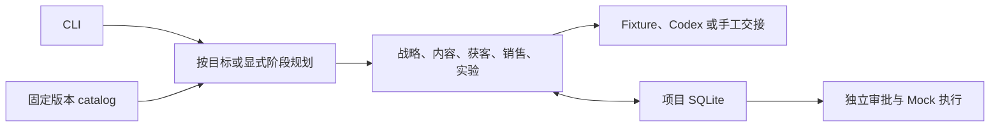

# GTM Harness 1.0.0-rc.2

## 架构与任务选择



运行时只调度所选角色，并在所选节点之间检查上游完成状态。内容可单独用项目背景起草，获客可单独做渠道方案，销售不依赖获客。实验接收所选且已完成的上游产物。`--goal` 使用可检查的关键词规则，未匹配时要求 `--stages`。默认 `start` 维持旧双阶段兼容行为。五个固定 SHA 继续从合集安装目录清单读取，见[发布验收](../V1_RELEASE_READINESS.md)。

## Codex 宿主

从已有 SQLite 项目开始。可用 `prepare-pins DEST` 把固定版本下载到新目录，再用 `--checkouts-dir DEST` 调用。已有克隆也可用 `--checkout` 指定，必须包含 catalog 对应的提交对象。

```sh
python -m harness --db "$db" start model-demo --execution model --stages strategy launch
python -m harness --db "$db" resume model-demo --model YOUR_AVAILABLE_CODEX_MODEL \
  --checkout "strategy=$strategy_repo" --checkout "launch=$launch_repo" --timeout 180
```

Codex CLI 必须已经认证。Harness 从固定 Git 对象读取 `SKILL.md`、Markdown 参考和模板。调用发起前关闭 shell、统一执行、插件、MCP 和 Web Search，宿主只读，无审批升级。代码检查宿主是否报告被禁用的工具活动。回执保留文档摘要、请求模型、宿主完成事件、收到的 token 计数和耗时。缺失 token 与实际货币费用按未知处理。

若 Codex 不可用，用 `start manual --execution handoff --stages strategy launch` 创建手工运行。请将下列输出与结果文件放到仓库外已有的工作目录。

```sh
python -m harness --db "$db" handoff manual --checkout "strategy=$strategy_repo" > "$work/request.json"
python -m harness --db "$db" step manual --results "$work/results.json"
```

把 `tasks[].prompt` 和 `output_schema` 交给受控宿主，结果文件写成数组 `[{"input_digest":"从请求复制","result":{"recommendation":"...","citations":[]}}]`。为下一阶段再生成一份请求并填入对应结果。导入时核对输入摘要，输出归类为 `handoff`。手工宿主的工具权限由操作者负责。

## 状态、升级与回滚

SQLite `user_version=3`。打开旧双阶段数据库会事务迁移，保留原计划、固定版本和已提交结果。迁移前停止其他进程并备份。需要回滚程序时恢复迁移前的数据库备份，旧二进制无法读取新版库。活跃数据库请通过 SQLite backup API 创建一致副本。

`restore REVISION` 追加新的上下文版本，恢复指定版本的值和字段存在性。已保存的历史版本和产物保留。任务完成、引用和草稿用同一事务提交。输入变化或另一尝试接手后，提交边界拒绝旧响应。`status` 列出计划、项目版本、证据索引、决策、草稿和尝试历史。短 Markdown 与状态存于同库。

## 证据与权限

使用 `research TOPIC TERM` 从公开 GitHub 检索。TOPIC 可用 `market`、`competitor`、`icp` 或 `channel` 来标识研究目的。可用 `--repository OWNER/REPO` 精确查询，按词搜索最多 5 个结果。接入只读取固定 GitHub HTTPS API，禁止跳转，限响应大小和请求时限。它保留观察日和采集时刻、GitHub 标准 URL、源 ID、原始选定字段和规范化摘录。搜索范围限 GitHub 仓库，星标或分叉不足以支持需求、采用和市场规模判定。[GitHub Search API](https://docs.github.com/en/rest/search/search)

`change` 可以导入或替换 `market_sources`。人工导入的自由文本保留供审核，当前 Codex 仅看到 GitHub 规范化观察。结构化引用须逐字匹配有效摘录，未知、冲突或过期来源不能进入引用。源 ID 和摘录摘要绑定到决策与草稿，变更后沿已保存的上游依赖传递。对声明为市场相关、尚无具体引用的结果，候选来源集合变化会触发复核。矛盾检查依赖同一 claim ID 的相反立场。自由文本的常见数字声明会在导出时提示复核，任意自然语言的真伪仍需人审。

`export RUN` 默认输出 Markdown，`--format json` 附完整的引用检查、可用来源、尝试记录和依赖。部分运行明确标为 incomplete，过期产物用历史 ID 标识。导出的文字均须人工审核后才可使用。

审批命令 `approve-mock`、`revoke-mock`、`execute-mock` 与 `receipts` 专用于 Mock Executor。授权来自受信的本机 POSIX 账户，绑定项目版本和完整操作摘要。操作与上下文变动后授权失效。提交前消耗授权并记录结果未知，确认后再写回执。超时或崩溃不会自动重试同一操作 ID。真实发布、触达、CRM 和广告仍待独立接入。本机数据库只提供给受信操作者。新库在 POSIX 上按账户读写权限创建。

[Schema 与 Skill 输入输出契约](harness-contract.md)

可在示例项目验证本机授权。第一次执行应报拒绝，批准后仅产生一条模拟成功回执，再次执行会被拒绝。

```sh
python -m harness --db "$db" execute-mock examples/harness/mock-operation.json
python -m harness --db "$db" approve-mock examples/harness/mock-operation.json --ttl 300
python -m harness --db "$db" execute-mock examples/harness/mock-operation.json
python -m harness --db "$db" receipts
```


## 常见故障

| 现象 | 怎么处理 |
|---|---|
| GitHub TLS trust failed | 配置 Python 的受信 CA。使用 python.org 的 macOS Python 时可运行随安装器提供的证书安装程序，或把 `SSL_CERT_FILE` 指向系统认可的 CA bundle。保持 TLS 验证。 |
| GitHub 403、限流或不可达 | 稍后重试、缩小查询，或导入已审核的来源。模型可先生成带证据限制的方案。 |
| 找不到固定 Skill 内容 | 用 `prepare-pins` 准备新的目录。失败留下的目录可以检查，重试使用新目录。 |
| 缺少价格、能力或宿主凭证 | 用 `status` 查缺失字段。已确认后通过 `change` 补齐，或创建只含相应阶段的运行。Codex 未登录时使用手工交接。 |
| 模型执行失败或中断 | 已失败尝试用 `resume --retry`，原进程确认退出但状态仍运行时用 `resume --recover`。使用相同模型和固定 Skill。 |
