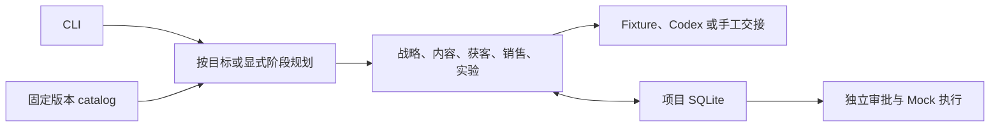

# GTM Harness 1.0.0-rc.1

## 架构与任务选择



运行时只调度所选角色，并在所选节点之间检查上游完成状态。内容可单独用项目背景起草，获客可单独做渠道方案，销售不依赖获客。实验接收所选且已完成的上游产物。`--goal` 使用可检查的关键词规则，未匹配时要求 `--stages`。默认 `start` 维持旧双阶段兼容行为。五个固定 SHA 继续从合集安装目录清单读取，见[发布验收](../V1_RELEASE_READINESS.md)。

## Codex 宿主

先在仓库外准备 Skill 仓库的 Git 克隆，并保证 catalog 对应提交对象存在。示例从已有 SQLite 项目开始。

```sh
python -m harness --db "$db" start model-demo --execution model --stages strategy launch
python -m harness --db "$db" resume model-demo --model YOUR_AVAILABLE_CODEX_MODEL \
  --checkout "strategy=$strategy_repo" --checkout "launch=$launch_repo" --timeout 180
```

Codex CLI 必须已经认证。Harness 从固定 Git 对象读取 `SKILL.md`、Markdown 参考和模板。调用发起前关闭 shell、统一执行、插件、MCP 和 Web Search，宿主只读，无审批升级。代码检查宿主是否报告被禁用的工具活动。回执保留文档摘要、请求模型、宿主完成事件、收到的 token 计数和耗时。缺失 token 与实际货币费用按未知处理。

若 Codex 不可用，用 `start manual --execution handoff --stages strategy launch` 创建手工运行。请将下列输出与结果文件放到仓库外已有的工作目录。

```sh
python -m harness --db "$db" handoff manual --checkout "strategy=$strategy_repo" > "$work/request.json"
python -m harness --db "$db" step manual --results "$work/results.json"
```

把 `tasks[].prompt` 和 `output_schema` 交给受控宿主，结果文件写成数组 `[{"input_digest":"从请求复制","result":{"recommendation":"...","citations":[]}}]`。为下一阶段再生成一份请求并填入对应结果。导入时核对输入摘要，输出归类为 `handoff`。手工宿主的工具权限由操作者负责。

## 状态、升级与回滚

SQLite `user_version=3`。打开旧双阶段数据库会事务迁移，保留原计划、固定版本和已提交结果。迁移前停止其他进程并备份。需要回滚程序时恢复迁移前的数据库备份，旧二进制无法读取新版库。活跃数据库请通过 SQLite backup API 创建一致副本。

`restore REVISION` 追加新的上下文版本，恢复指定版本的值和字段存在性。已保存的历史版本和产物保留。任务完成、引用和草稿用同一事务提交。输入变化或另一尝试接手后，提交边界拒绝旧响应。`status` 列出计划、项目版本、证据索引、决策、草稿和尝试历史。短 Markdown 与状态存于同库。

## 证据与权限

`change` 接收带 `market_sources` 的项目补丁。来源可由操作者从有权使用的搜索、浏览或 MCP 导出，也可由 Python 调用者向 `Gateway(readers=...)` 注入已审查的只读提供方。自动化测试使用本地 provider。Codex 子进程目前没有直接的研究工具。

缺证据或有冲突时，战略与相关草稿标记 `needs_review`。未知或过期引用会失败。矛盾检查基于操作者声明的 claim ID 与立场，网页内容、自然语言论断与引文之间的支持关系仍需人工核验。

审批命令 `approve-mock`、`revoke-mock`、`execute-mock` 与 `receipts` 专用于 Mock Executor。授权来自受信的本机 POSIX 账户，绑定项目版本和完整操作摘要。操作与上下文变动后授权失效。提交前消耗授权并记录结果未知，确认后再写回执。超时或崩溃不会自动重试同一操作 ID。真实发布、触达、CRM 和广告仍待独立接入。本机数据库只提供给受信操作者。新库在 POSIX 上按账户读写权限创建。

[Schema 与 Skill 输入输出契约](harness-contract.md)

可在示例项目验证本机授权。第一次执行应报拒绝，批准后仅产生一条模拟成功回执，再次执行会被拒绝。

```sh
python -m harness --db "$db" execute-mock examples/harness/mock-operation.json
python -m harness --db "$db" approve-mock examples/harness/mock-operation.json --ttl 300
python -m harness --db "$db" execute-mock examples/harness/mock-operation.json
python -m harness --db "$db" receipts
```
